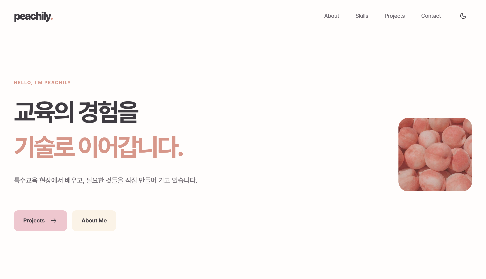
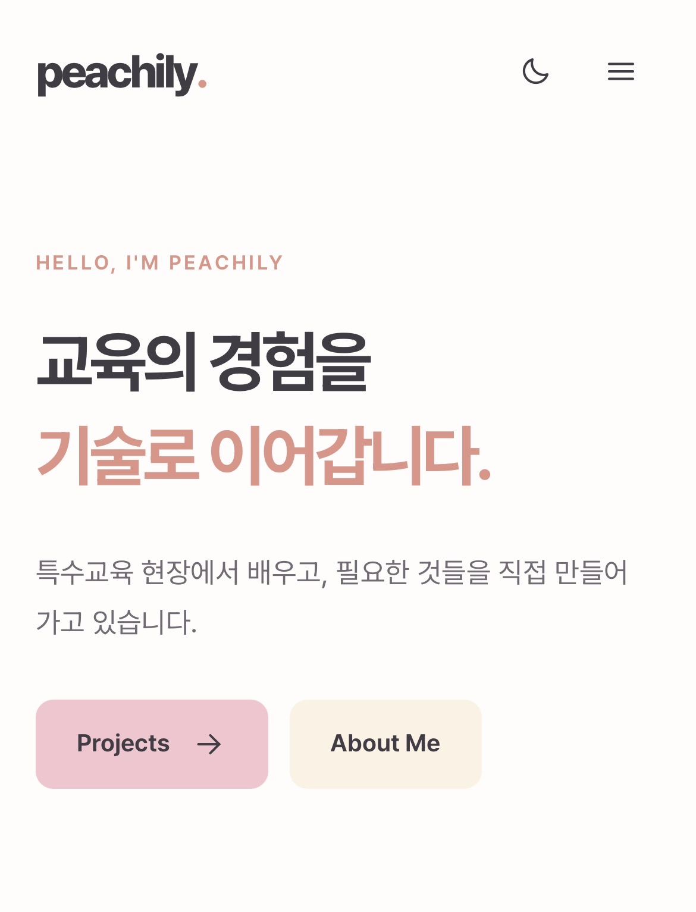
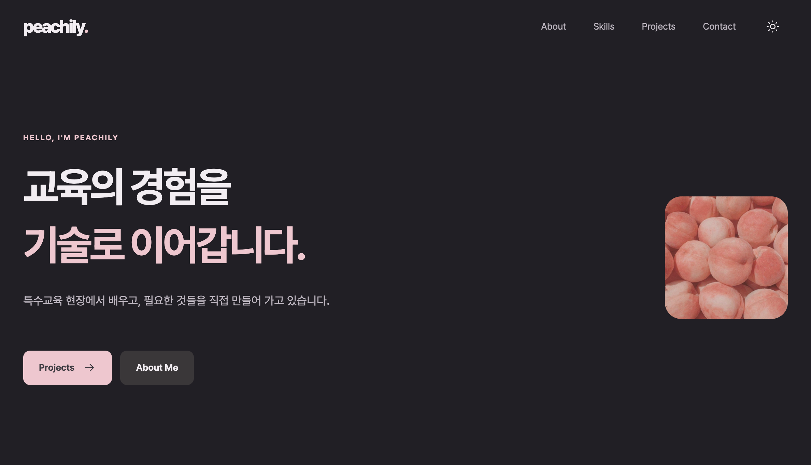

# peachily

개인 개발 포트폴리오입니다.
교육 현장에서 만든 학습 도구와 학교 업무 지원 도구, 다양한 개발 프로젝트를 소개하는 반응형 웹사이트입니다.

**[웹사이트 바로가기](https://peachily.dev/)**

---

## 구현 방식

### 기술 스택
순수 HTML, CSS, JavaScript로 구현했습니다.

| 구분 | 기술 |
| --- | --- |
| Frontend | HTML5, CSS3, Vanilla JavaScript (ES Modules) |
| API | GitHub REST API, Formspree |
| Deployment | GitHub Pages, Cloudflare |


### DOM 조작과 상태 관리
사용자 이벤트에 따라 상태를 변경하고, 변경된 상태를 화면에 반영하는 방식으로 기능을 구현했습니다.

| 기능 | 이벤트 → 상태 변경 → 화면 업데이트 |
| --- | --- |
| 다크 모드 | 버튼 클릭 → 테마 상태 변경 → 전체 화면 색상 변경 |
| 프로젝트 조회 | API 요청 → 로딩·성공·오류 상태 변경 → 프로젝트 목록 및 안내 메시지 변경 |
| 프로젝트 필터 | 버튼 클릭 또는 언어 선택 → 필터 상태 변경 → 표시할 카드 목록 변경 |
| 문의 폼 | 입력·제출 → 검증 및 전송 상태 변경 → 오류·성공 메시지 표시 |

GitHub API는 `fetch`와 `async/await`로 호출하며, `map`, `filter`, `forEach` 등의 배열 메서드를 활용합니다.


### 반응형 레이아웃과 인터랙션

- **레이아웃:** Flexbox와 CSS Grid 활용
- **반응형 기준:** 768px(태블릿), 1024px(데스크톱)
- **헤더 스타일 변경:** 스크롤 60px 초과
- **상단 이동 버튼 표시:** 스크롤 300px 초과
- **스크롤 등장 효과:** IntersectionObserver `threshold: 0.2`
- **부드러운 스크롤:** 섹션 앵커 이동 및 스크롤 애니메이션
- **모션 감소 설정:** `prefers-reduced-motion` 지원


### 파일 구조

```text
B1-1/
├── index.html                 # 페이지 구조와 콘텐츠
├── css/
│   ├── tokens.css             # 색상·글꼴·간격 등 디자인 변수
│   ├── base.css               # 기본 요소와 공통 스타일
│   ├── layout.css             # 섹션과 그리드 배치
│   ├── components.css         # 버튼·카드·폼 등 구성 요소
│   └── responsive.css         # 화면 크기별 반응형 스타일
├── js/
│   ├── main.js                # 기능 초기화
│   ├── config.js              # 공개 설정과 프로젝트 정보
│   ├── navigation.js          # 내비게이션과 스크롤 버튼
│   ├── theme.js               # 라이트·다크 모드
│   ├── animations.js          # 스크롤 등장·타이핑 효과
│   ├── technologies.js        # 기술 목록과 공통 아이콘 배지
│   ├── projects.js            # GitHub 프로젝트 조회·필터·표시
│   └── contact.js             # 문의 폼 검증과 제출
├── assets/
│   ├── icons/                 # 파비콘·UI·기술 로고
│   ├── images/                # 프로필 이미지
│   ├── licenses/              # 외부 아이콘 출처와 라이선스
│   └── screenshots/           # 데스크톱·모바일·다크 모드 화면 캡처
├── README.md
├── CNAME                     # 연결할 도메인
└── .nojekyll                 # GitHub Pages 설정
```

---

## 주요 기능

- **반응형 웹** — 모바일·태블릿·데스크톱에 맞춘 레이아웃과 햄버거 메뉴

<p align="center">
  
  
</p>

- **프로젝트 조회** — GitHub REST API를 활용한 프로젝트 카드 생성 및 카테고리·언어별 필터링
- **상태별 UI** — 프로젝트 로딩, 성공, 오류, 빈 결과 표시 및 재시도
- **다크 모드** — 테마 전환, localStorage 저장, 시스템 테마 설정 감지

- **스크롤 인터랙션** — 부드러운 섹션 이동, 등장 애니메이션, 상단 이동 버튼
- **문의 폼** — 입력값 유효성 검사 및 Formspree 이메일 전송
- **접근성** — 시맨틱 HTML, 키보드 탐색, 대체 텍스트, 모션 감소 설정 지원
