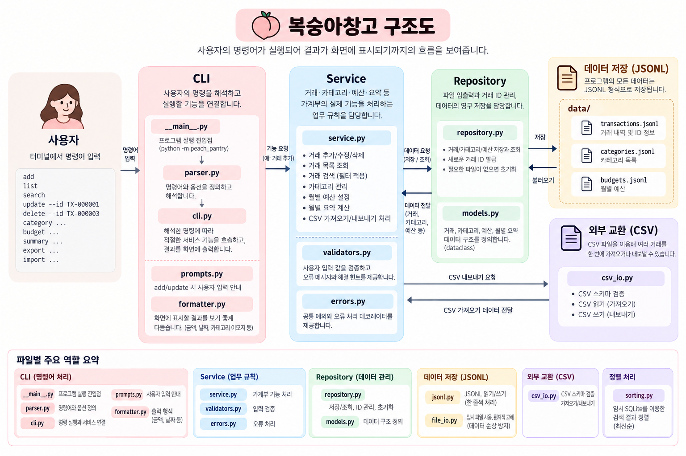

# 복숭아창고

**수입과 지출을 차곡차곡 기록하는 콘솔 가계부**

Python 표준 라이브러리만 사용하여 거래·카테고리·월별 예산을 JSONL 파일에 저장합니다.

---

## 1. 프로젝트 구조

- **CLI:** 사용자 명령어와 입력·출력을 처리합니다.
- **서비스(Service):** 거래 관리, 입력 검증, 계산 등 프로그램의 업무 규칙을 담당합니다.
- **저장소(Repository):** 파일 입출력과 거래 ID 관리, 데이터 영구 저장을 담당합니다.
- **데이터 모델(Model):** 거래 내역 등 프로그램에서 사용하는 데이터 구조를 정의합니다.
- **파일 관리(`file_io.py`):** 안전한 파일 저장 기능을 공통으로 구현하여 JSONL과 CSV 처리에 재사용합니다.



```text
B2-1/
├── peach_pantry/          # 실행에 사용하는 패키지
│   ├── __init__.py        # Python 패키지 선언
│   ├── __main__.py        # python -m peach_pantry 진입점
│   ├── cli.py             # 명령 실행과 서비스·출력 연결
│   ├── parser.py          # argparse 명령·옵션·도움말 등록
│   ├── prompts.py         # add/update 대화형 입력과 재입력
│   ├── service.py         # 거래·카테고리·예산·요약의 업무 규칙
│   ├── repository.py      # 모델 저장·복원, 초기화, 거래 ID 관리
│   ├── models.py          # Transaction/Category/Budget/MonthlySummary dataclass
│   ├── validators.py      # 사용자 입력 검증과 해결 힌트
│   ├── formatter.py       # 한국어 화면, 카테고리 이모지, 금액 출력
│   ├── errors.py          # 공통 예외와 오류 처리 데코레이터
│   ├── file_io.py         # JSONL·CSV 공통 임시 파일 및 원자적 교체
│   ├── jsonl.py           # yield 기반 JSONL 읽기·쓰기
│   ├── csv_io.py          # CSV 스키마 검증·읽기·쓰기
│   └── sorting.py         # 임시 SQLite 파일을 이용한 검색 정렬
├── tests/                 # 단위·파일 안전성·CLI 통합 테스트
├── .gitignore
└── README.md
```

---

## 2. 실행 방법

Python **3.10 이상**이 설치된 환경에서 실행하며, 별도의 외부 라이브러리 설치는 필요하지 않습니다.

터미널에서 `B2-1` 폴더로 이동한 후 프로그램을 실행합니다.

```bash
cd B2-1
python3 -m peach_pantry
```

### 1. 거래 추가 — `add`

수입과 지출 내역을 등록하는 기능입니다. 날짜, 유형, 카테고리, 금액, 메모, 태그를 차례대로 입력하면 거래 ID가 자동으로 발급됩니다.

| 입력 항목 | 설명 | 예시 |
| --- | --- | --- |
| 날짜 | `YYYY-MM-DD` 형식 | `2026-10-22` |
| 유형 | `income` 또는 `expense` | `expense` |
| 카테고리 | 등록된 카테고리 이름 | `식비` |
| 금액 | 0보다 큰 정수 | `12000` |
| 메모 | 선택 입력 | `점심 식사` |
| 태그 | 쉼표로 구분, 선택 입력 | `점심,외식` |

**실행 예시**

```bash
python3 -m peach_pantry add
```

```text
날짜: 2026-10-22
유형: expense
카테고리: 식비
금액: 12000
메모: 점심 식사
태그: 점심,외식
```

시연을 위해 같은 명령어로 다음 거래도 추가합니다.

| 날짜 | 유형 | 카테고리 | 금액 | 메모 | 태그 |
| --- | --- | --- | ---: | --- | --- |
| 2026-10-23 | income | 급여 | 3000000 | 10월 급여 | 월급 |
| 2026-10-24 | expense | 카페 | 5500 | 아이스 라떼 | 음료 |

빈 데이터에서 시작했다면 거래 ID는 `TX-000001`부터 순서대로 발급됩니다.

관련 코드: [`prompts.py`](peach_pantry/prompts.py) · [`service.py`](peach_pantry/service.py)

### 2. 거래 목록 — `list`

저장된 거래를 날짜 기준 최신순으로 조회합니다. 기본적으로 최근 10건을 표시합니다.

| 옵션 | 설명 | 기본값 |
| --- | --- | --- |
| `--limit N` | 조회할 거래 개수 | `10` |

**실행 예시**

```bash
python3 -m peach_pantry list
```

최근 3건만 조회하려면 다음과 같이 실행합니다.

```bash
python3 -m peach_pantry list --limit 3
```

관련 코드: [`service.py`](peach_pantry/service.py) · [`formatter.py`](peach_pantry/formatter.py)

### 3. 거래 검색 — `search`

기간, 카테고리, 유형, 메모 키워드, 태그를 기준으로 거래를 검색합니다. 여러 옵션을 함께 사용하면 모든 조건을 만족하는 거래만 표시합니다.

| 옵션 | 설명 | 예시 |
| --- | --- | --- |
| `--from` | 검색 시작 날짜 | `2026-10-01` |
| `--to` | 검색 종료 날짜 | `2026-10-31` |
| `--category` | 카테고리 | `식비` |
| `--type` | 수입 또는 지출 | `expense` |
| `--q` | 메모에 포함된 키워드 | `점심` |
| `--tag` | 특정 태그 | `외식` |

**실행 예시**

기간 검색:

```bash
python3 -m peach_pantry search --from 2026-10-01 --to 2026-10-31
```

카테고리 검색:

```bash
python3 -m peach_pantry search --category 식비
```

유형 검색:

```bash
python3 -m peach_pantry search --type expense
```

메모 검색:

```bash
python3 -m peach_pantry search --q 점심
```

태그 검색:

```bash
python3 -m peach_pantry search --tag 외식
```

복합 조건 검색:

```bash
python3 -m peach_pantry search --category 식비 --type expense --q 점심
```

관련 코드: [`service.py`](peach_pantry/service.py) · [`sorting.py`](peach_pantry/sorting.py)

### 4. 거래 수정 — `update`

거래 ID를 지정하여 기존 거래를 수정합니다. 변경하지 않을 항목은 Enter를 누르면 기존 값이 유지됩니다.

| 옵션 | 설명 | 예시 |
| --- | --- | --- |
| `--id` | 수정할 거래 ID (필수) | `TX-000001` |

**실행 예시**

```bash
python3 -m peach_pantry update --id TX-000001
```

날짜와 유형은 Enter로 유지하고, 금액과 메모를 변경합니다.

```text
날짜: [Enter]
유형: [Enter]
카테고리: [Enter]
금액: 15000
메모: 점심 식사와 간식
태그: [Enter]
```

수정된 거래를 확인합니다.

```bash
python3 -m peach_pantry search --category 식비
```

관련 코드: [`prompts.py`](peach_pantry/prompts.py) · [`service.py`](peach_pantry/service.py)

### 5. 거래 삭제 — `delete`

거래 ID를 지정하여 저장된 거래를 삭제합니다. 존재하지 않는 ID를 입력하면 오류 메시지를 표시합니다.

| 옵션 | 설명 | 예시 |
| --- | --- | --- |
| `--id` | 삭제할 거래 ID (필수) | `TX-000003` |

**실행 예시**

앞에서 추가한 카페 거래를 삭제합니다.

```bash
python3 -m peach_pantry delete --id TX-000003
```

삭제 결과를 확인합니다.

```bash
python3 -m peach_pantry list
```

관련 코드: [`service.py`](peach_pantry/service.py) · [`repository.py`](peach_pantry/repository.py)

### 6. 카테고리 관리 — `category`

거래에 사용할 카테고리를 추가하거나 조회하고, 사용하지 않는 카테고리를 삭제합니다.

| 명령어 | 설명 |
| --- | --- |
| `category list` | 등록된 카테고리 조회 |
| `category add 이름` | 새로운 카테고리 추가 |
| `category remove 이름` | 기존 카테고리 삭제 |

**실행 예시**

기본 카테고리를 확인합니다.

```bash
python3 -m peach_pantry category list
```

새로운 카테고리를 추가합니다.

```bash
python3 -m peach_pantry category add 여행
```

추가 결과를 확인합니다.

```bash
python3 -m peach_pantry category list
```

추가한 카테고리를 삭제합니다.

```bash
python3 -m peach_pantry category remove 여행
```

기존 거래에서 사용 중인 카테고리는 삭제할 수 없습니다.

관련 코드: [`service.py`](peach_pantry/service.py) · [`repository.py`](peach_pantry/repository.py)

### 7. 예산 설정 — `budget`

월별 지출 예산을 설정합니다. 같은 월의 예산을 다시 설정하면 기존 금액이 변경됩니다.

| 옵션 | 설명 | 예시 |
| --- | --- | --- |
| `--month` | 예산을 설정할 월 (필수) | `2026-10` |
| `--amount` | 예산 금액 (필수) | `300000` |

**실행 예시**

10월 예산을 300,000원으로 설정합니다.

```bash
python3 -m peach_pantry budget set --month 2026-10 --amount 300000
```

관련 코드: [`service.py`](peach_pantry/service.py) · [`repository.py`](peach_pantry/repository.py)

### 8. 월별 요약 — `summary`

지정한 월의 총수입, 총지출, 잔액과 카테고리별 지출 순위를 확인합니다. 예산이 설정되어 있다면 예산 사용률도 표시합니다.

| 옵션 | 설명 | 기본값 |
| --- | --- | --- |
| `--month` | 조회할 월 (필수) | 없음 |
| `--top N` | 표시할 지출 상위 카테고리 개수 | `3` |

**실행 예시**

10월 수입과 지출을 확인합니다.

```bash
python3 -m peach_pantry summary --month 2026-10
```

지출 상위 5개 카테고리를 확인합니다.

```bash
python3 -m peach_pantry summary --month 2026-10 --top 5
```

예산 초과 경고를 확인하려면 예산을 10,000원으로 변경한 후 다시 조회합니다.

```bash
python3 -m peach_pantry budget set --month 2026-10 --amount 10000
python3 -m peach_pantry summary --month 2026-10
```

관련 코드: [`service.py`](peach_pantry/service.py) · [`formatter.py`](peach_pantry/formatter.py)

### 9. CSV 내보내기 — `export`

거래 내역을 CSV 파일로 저장합니다. 특정 월이나 날짜 범위를 지정하여 필요한 거래만 내보낼 수 있습니다.

| 옵션 | 설명 | 예시 |
| --- | --- | --- |
| `--out` | 저장할 CSV 파일 경로 (필수) | `october.csv` |
| `--month` | 특정 월의 거래 | `2026-10` |
| `--from` | 시작 날짜 | `2026-10-01` |
| `--to` | 종료 날짜 | `2026-10-31` |

`--month`와 날짜 범위 조건은 함께 사용할 수 없습니다.

**실행 예시**

10월 거래를 내보냅니다.

```bash
python3 -m peach_pantry export --out october.csv --month 2026-10
```

기간을 지정하여 내보냅니다.

```bash
python3 -m peach_pantry export --out records.csv --from 2026-10-01 --to 2026-10-31
```

관련 코드: [`csv_io.py`](peach_pantry/csv_io.py) · [`file_io.py`](peach_pantry/file_io.py)

### 10. CSV 가져오기 — `import`

CSV 파일에 저장된 여러 거래를 한 번에 가져옵니다. 모든 행을 검증한 후 저장하며, 잘못된 데이터가 있으면 전체 가져오기를 취소합니다.

| 옵션 | 설명 | 예시 |
| --- | --- | --- |
| `--from` | 가져올 CSV 파일 경로 (필수) | `october.csv` |

**실행 예시**

앞에서 내보낸 CSV 파일을 별도의 데이터 폴더로 가져옵니다. 기존 거래와 중복 저장되지 않도록 새로운 폴더를 사용합니다.

```bash
python3 -m peach_pantry --data-dir ./import_demo import --from october.csv
```

가져온 거래를 확인합니다.

```bash
python3 -m peach_pantry --data-dir ./import_demo list
```

CSV 파일의 컬럼과 작성 규칙은 아래 **CSV 파일 형식** 항목을 참고합니다.

관련 코드: [`csv_io.py`](peach_pantry/csv_io.py) · [`service.py`](peach_pantry/service.py)

---

## 3. 데이터

### 1) 저장: JSONL 형식

거래 내역, 카테고리, 월별 예산은 **JSONL 형식**으로 저장됩니다.
JSONL은 한 줄에 하나의 JSON 데이터를 기록하는 파일 형식입니다.
별도의 데이터베이스 없이 파일만으로 데이터를 관리할 수 있으며, 한 줄에 하나의 JSON 데이터를 기록하여 저장 내용을 확인하기 쉽습니다.

기본 저장 위치는 프로그램을 실행하는 폴더의 `data/`입니다.

```text
data/
├── transactions.jsonl    # 거래 내역 및 ID 정보
├── categories.jsonl      # 카테고리 목록
└── budgets.jsonl         # 월별 예산
```

각 파일은 프로그램 실행 시 필요한 경우 자동으로 생성되며, 프로그램을 종료해도 저장된 데이터는 유지됩니다.

저장 위치를 변경하려면 `--data-dir` 옵션을 사용합니다.

```bash
python3 -m peach_pantry --data-dir ./my_data list
```

파일을 수정하거나 삭제할 때는 임시 파일에 변경 내용을 기록한 후 교체하여 기존 데이터가 손상될 위험을 줄입니다.

관련 코드: [`repository.py`](peach_pantry/repository.py) · [`jsonl.py`](peach_pantry/jsonl.py) · [`file_io.py`](peach_pantry/file_io.py)

### 2) 외부 교환: CSV 형식

CSV 파일을 이용해 여러 거래를 한 번에 가져오거나 다른 프로그램에서 사용할 수 있도록 내보낼 수 있습니다.
CSV는 엑셀 등 다양한 프로그램에서 활용할 수 있는 형식으로, 거래 내역을 다른 프로그램으로 옮기거나 외부 데이터를 가져오기 위해 사용합니다.

CSV 파일은 **UTF-8 인코딩**을 사용하며, 첫 번째 줄에 다음 여섯 개의 컬럼이 순서대로 포함되어야 합니다.

| 컬럼 | 필수 입력 | 설명 |
| --- | --- | --- |
| `date` | O | 거래 날짜 (`YYYY-MM-DD`) |
| `type` | O | 수입 `income` 또는 지출 `expense` |
| `category` | O | 등록된 카테고리 이름 |
| `amount` | O | 0보다 큰 정수 |
| `memo` | X | 거래 메모 |
| `tags` | X | 쉼표로 구분한 태그 |

메모와 태그는 값을 비워둘 수 있지만, CSV 파일에는 여섯 개 컬럼이 모두 있어야 합니다.

**CSV 파일 예시**

```csv
date,type,category,amount,memo,tags
2026-10-20,income,급여,1000000,10월 급여,월급
2026-10-21,expense,식비,12000,점심 식사,"점심,외식"
2026-10-22,expense,카페,5500,아이스 라떼,음료
```

태그처럼 하나의 값에 쉼표가 포함되면 큰따옴표로 감싸야 합니다.

CSV 가져오기는 모든 행을 검증한 후 저장하며, 잘못된 데이터가 있으면 전체 가져오기를 취소합니다. 내보내기는 지정한 월 또는 기간에 해당하는 거래를 CSV 파일로 생성합니다.

관련 코드: [`csv_io.py`](peach_pantry/csv_io.py)
